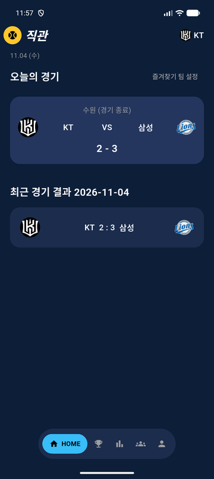
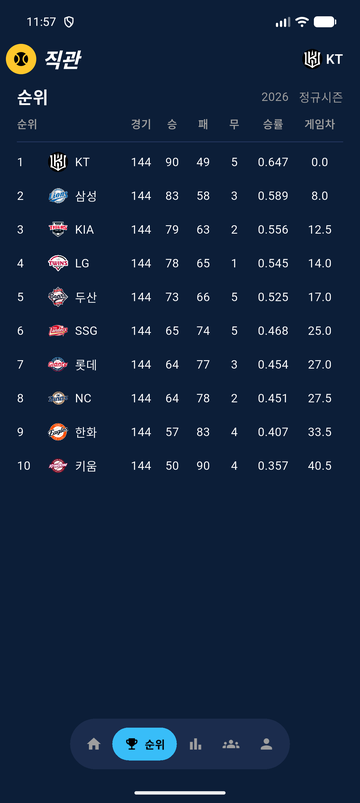
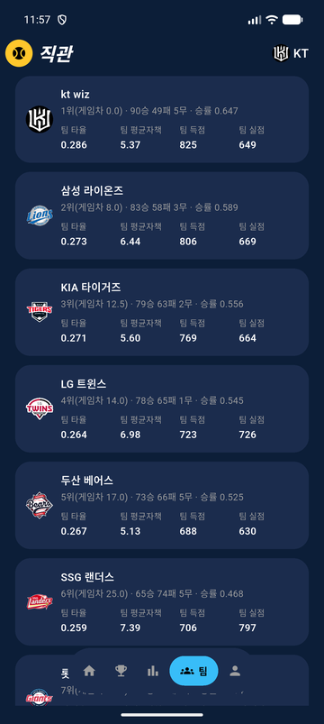
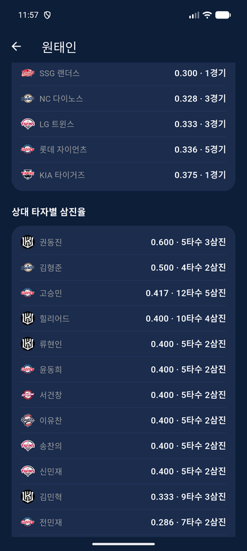
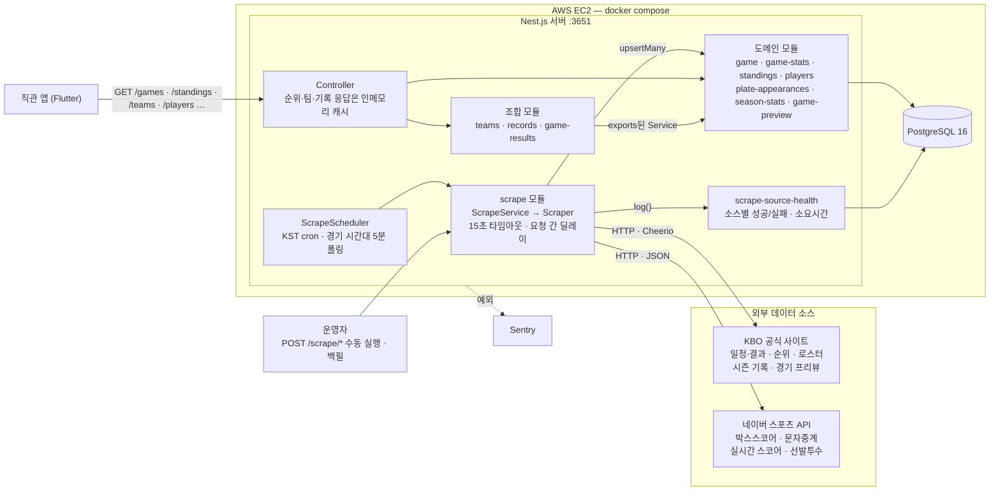
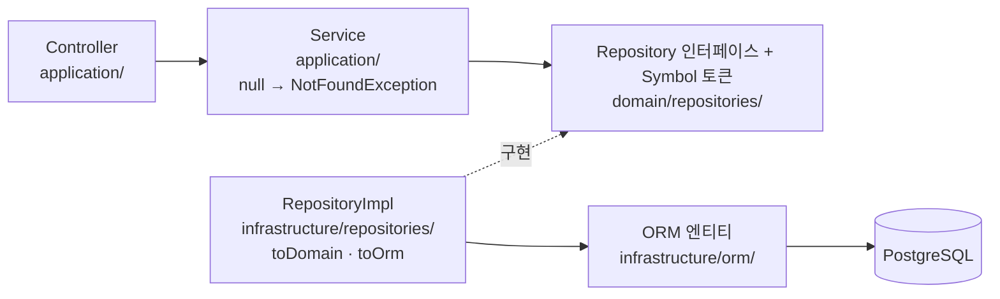
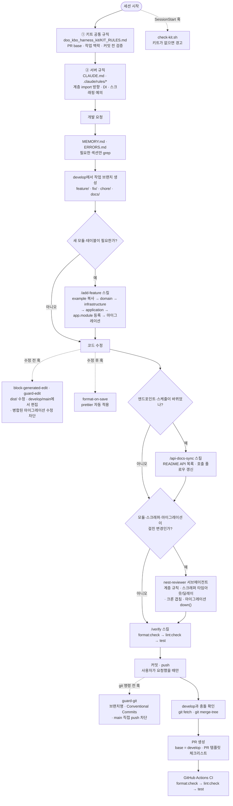

# doo_kbo_scraping_server

> KBO 공식 사이트와 네이버 스포츠에서 경기·순위·선수 기록을 주기적으로 스크래핑해 KBO 앱 [직관](https://github.com/shot013/doo_kbo_app)에 JSON API로 제공하는 Nest.js 서버

## 화면

이 서버의 API로 그리는 Flutter 앱 [직관(doo_kbo_app)](https://github.com/shot013/doo_kbo_app)의 실제 화면입니다 (2026-11-05, 2026 시즌 종료 시점 데이터). 각 화면 아래에 그 화면이 호출하는 API를 적었습니다.

<table>
  <tr>
    <td align="center" width="25%"></td>
    <td align="center" width="25%"></td>
    <td align="center" width="25%"></td>
    <td align="center" width="25%"></td>
  </tr>
  <tr>
    <td align="center"><b>HOME</b><br />오늘의 경기 · 최근 경기 결과<br /><code>GET /games</code><br /><code>GET /game-results/recent</code></td>
    <td align="center"><b>순위</b><br />정규시즌 순위표<br /><code>GET /standings</code></td>
    <td align="center"><b>팀</b><br />순위 + 팀 타율·평균자책·득점·실점<br /><code>GET /teams</code></td>
    <td align="center"><b>선수 상세</b><br />구단별 피안타율 · 상대 타자별 삼진율<br /><code>GET /players/:id</code></td>
  </tr>
</table>

## 사용 기술

| 영역 | 기술 |
| --- | --- |
| 런타임 · 프레임워크 | Node.js 20, TypeScript 5, Nest.js 11 (Express) |
| DB · ORM | PostgreSQL 16, TypeORM 1 (스키마는 마이그레이션으로만 변경) |
| 스크래핑 | `fetch`로 KBO 공식 사이트의 내부 API·페이지와 네이버 스포츠 API를 직접 호출, Cheerio로 HTML 파싱. 요청마다 15초 타임아웃, 요청 사이 딜레이 |
| 스케줄링 | `@nestjs/schedule` — KST 기준 cron, 경기 시간대에는 5분 간격으로 경기 상태 갱신 |
| 캐시 | `@nestjs/cache-manager` 인메모리 캐시 (순위·팀·기록 조회, `CACHE_TTL_MS` 기본 5분) |
| 모니터링 | Sentry (`@sentry/nestjs`), 스크랩 소스별 성공/실패·소요시간을 `scrape-source-health` 테이블에 기록 |
| 코드 품질 | ESLint 9 (`typescript-eslint` `recommendedTypeChecked`, 경고 0개), Prettier, Jest 30 |
| CI | GitHub Actions — PR과 push마다 `format:check` → `lint:check` → `test` |
| 배포 | Docker 멀티 스테이지 빌드 + docker compose (앱 · Postgres · 마이그레이션 러너), AWS EC2 |
| AI 개발 환경 | Claude Code + 공용 하네스 [doo_kbo_harness_kit](https://github.com/shot013/doo_kbo_harness_kit) |

## 아키텍처

스케줄러가 외부 소스를 스크래핑해 Postgres에 저장하고, 앱은 저장된 데이터만 조회합니다. 앱 요청이 외부 사이트로 바로 나가지 않습니다.



각 모듈은 `domain` / `infrastructure` / `application` 세 계층으로 나뉩니다. `domain`은 Nest와 TypeORM을 모르는 순수 TypeScript이고, `infrastructure`가 `domain`의 repository 인터페이스를 구현합니다. 다른 모듈의 service만 조합하는 `teams`·`records`·`game-results`는 `application`만 둡니다.



```
src/
  main.ts / instrument.ts   # 부트스트랩, 앱 로드 전 Sentry 초기화
  app.module.ts             # 모듈 등록만
  common/                   # database 설정, pagination, kbo(팀 코드 표)
  database/                 # TypeORM CLI용 DataSource, migrations/
  modules/
    game/  game-stats/  standings/  players/  plate-appearances/
    season-stats/  game-preview/  action-log/  scrape-source-health/
                            # domain / infrastructure / application 3계층
    teams/  records/  game-results/
                            # application만 (다른 모듈 service 조합)
    scrape/                 # 스크래퍼 + 스케줄러, 결과를 각 모듈 service로 저장
    example/                # 새 모듈을 만들 때 복사하는 템플릿 (인메모리)
```

API별 호출 경로는 아래 [API 호출 플로우](#api-호출-플로우), 새 모듈 추가 절차는 [docs/ARCHITECTURE.md](docs/ARCHITECTURE.md)에 있습니다.

## Claude Code로 개발하는 방식

이 저장소의 코드는 Claude Code가 규칙·스킬·훅·서브에이전트를 따라 작성합니다. 여러 저장소가 공유하는 규칙은 [doo_kbo_harness_kit](https://github.com/shot013/doo_kbo_harness_kit)(`KIT_RULES.md`)에 두고, 이 서버는 그 위에 `CLAUDE.md`와 `.claude/`로 서버 고유 규칙만 얹습니다.



### 예시: 선수 상세 페이지의 "상대 타자별 삼진율" 기능

위 [화면](#화면) 4번째 캡처의 "상대 타자별 삼진율"을 이 흐름으로 만들면 아래 순서가 됩니다. 결과물은 `plate-appearances` 모듈, `play-by-play` 스크래퍼, `GET /players/:id`의 `vsBatterStats` 필드입니다.

| 단계 | 동작하는 것 | 이 기능에서 하는 일 |
| --- | --- | --- |
| 요청 | — | "선수 상세 페이지에 투수가 상대한 타자별 삼진율을 보여줄 데이터를 만들어줘" |
| 맥락 확인 | `KIT_RULES.md` 작업 맥락 → `MEMORY.md` | "실시간 경기 데이터는 네이버 스포츠" 결정 섹션만 읽고, 타석 데이터 소스로 네이버 문자중계 API를 고름 |
| 브랜치 | `guard-edit` 훅, `guard-git` 훅 | `develop`에서 바로 고치려 하면 차단 → `feature/batter-pitcher-matchup-stats` 생성, 브랜치명 규약 검사 |
| 새 모듈 | `/add-feature` 스킬, `.claude/rules/architecture.md` | `example`을 복사해 `plate-appearances` 모듈 생성: 도메인 엔티티, `PLATE_APPEARANCE_REPOSITORY` 토큰, `*.orm-entity.ts`, `toDomain`/`toOrm` 구현체, `app.module.ts` 등록, 마이그레이션 생성 |
| 스크래퍼 | `CLAUDE.md` 공통 규칙 (스크래핑 예의) | `play-by-play.scraper.ts`가 15초 타임아웃(`scrape-request.ts`)을 쓰고 이닝 요청 사이에 딜레이를 둠, 스케줄러에 등록 |
| 모듈 조합 | `.claude/rules/architecture.md` (다른 모듈은 exports된 service로) | `players`가 `PlateAppearanceService`를 주입받아 `GET /players/:id`에 `vsBatterStats`를 붙임 — 다른 모듈의 repository 토큰은 쓰지 않음 |
| 편집 중 | `format-on-save`, `guard-edit` 훅 | 저장할 때마다 prettier 적용, 이미 병합된 마이그레이션은 수정 차단 |
| API 문서 | `/api-docs-sync` 스킬 | README `GET /players/:id` 설명에 `vsBatterStats`, `## API 목록`에 `/scrape/play-by-play`와 실행 시각 추가 |
| 리뷰 | `nest-reviewer` 서브에이전트 | 새 모듈·스크래퍼·마이그레이션이 걸려 있어 위임: 계층 규칙, 스크래퍼 타임아웃·딜레이, 크론 겹침, 마이그레이션 `down()` 점검 |
| 검증 | `/verify` 스킬 | `format:check` → `lint:check` → `test` |
| 커밋 | `guard-git` 훅, `.claude/rules/git-workflow.md` | `feat(plate-appearances): ...` — scope는 모듈 디렉터리명 |
| PR | `KIT_RULES.md` git, PR 템플릿 | `git merge-tree`로 `develop`과 충돌이 없는지 확인 → base `develop`으로 PR, "README API 목록 업데이트" 체크 |

### 규칙을 어디에 두는가

매 턴 컨텍스트에 들어가는 규칙은 최소로 두고, 기계적으로 판정할 수 있는 것은 훅으로, 특정 작업에서만 필요한 절차는 스킬로 내립니다.

| 층 | 위치 | 언제 동작하나 | 이 저장소에서 하는 일 |
| --- | --- | --- | --- |
| 규칙 | 키트 `KIT_RULES.md` → `CLAUDE.md` → `.claude/rules/*` | 항상 (매 턴) | 계층 import 방향, DI·repository 배치, 예외 변환 위치, 스크래핑 예의, PR·충돌 확인 |
| 훅 | `.claude/hooks/*` (`.claude/settings.json`에 등록) | 도구 호출 때 자동 | 키트 확인, 생성 파일·병합된 마이그레이션 보호, 자동 포맷, git 규약 강제 |
| 스킬 | `.claude/skills/*` | 관련 작업일 때 | `/add-feature`, `/api-docs-sync`, `/verify` |
| 서브에이전트 | `.claude/agents/nest-reviewer.md` | 여러 모듈·스크래퍼·마이그레이션 변경 후 | 린터가 못 잡는 아키텍처·스크래퍼 리뷰 |

훅·스킬별 자세한 설명은 [docs/CLAUDE_CODE.md](docs/CLAUDE_CODE.md)에 있습니다.

## 서버 구동 방법

### 1. 의존성 설치

```bash
npm install
```

### 2. 환경변수 설정

`.env.example`을 복사해 `.env`를 만들고 필요 시 값을 수정합니다.

```bash
cp .env.example .env
```

| 변수 | 설명 | 기본값 |
| --- | --- | --- |
| `PORT` | 앱이 리스닝할 포트 | `3651` |
| `DB_HOST` | Postgres 호스트 | `localhost` |
| `DB_PORT` | Postgres 포트 | `5432` |
| `DB_USERNAME` | Postgres 사용자 | `postgres` |
| `DB_PASSWORD` | Postgres 비밀번호 | `postgres` |
| `DB_DATABASE` | Postgres 데이터베이스명 | `doo_kbo` |
| `DB_SYNCHRONIZE` | TypeORM synchronize 여부 (운영에서는 `false` 유지) | `false` |
| `DB_LOGGING` | TypeORM 쿼리 로깅 여부 | `false` |

### 3. 로컬 Postgres 실행 (Docker)

```bash
docker compose up -d
```

`docker-compose.yml`은 `.env`의 `DB_USERNAME`/`DB_PASSWORD`/`DB_DATABASE`/`DB_PORT` 값을 사용해 `postgres:16-alpine` 컨테이너를 띄웁니다.

### 4. 마이그레이션 실행

```bash
npm run migration:run
```

스키마 변경 후 마이그레이션 파일을 새로 생성하려면 `npm run migration:generate -- src/database/migrations/<이름>`, 되돌리려면 `npm run migration:revert`를 사용합니다.

### 5. 앱 실행

```bash
npm run start:dev   # watch 모드 (개발용, 권장)
npm run start       # 1회 실행
npm run start:prod  # 빌드 산출물(dist) 실행 (사전에 npm run build 필요)
```

정상 기동되면 `http://localhost:<PORT>`에서 서버가 응답합니다 (`PORT` 미설정 시 `3000`).

### 참고: 테스트/린트

```bash
npm run format:check   # 포맷 체크
npm run lint:check     # 정적 분석 (경고 0개, CI와 동일 — npm run lint는 자동 수정 포함)
npm run test           # 전체 테스트
```

## 배포

프로덕션용 `Dockerfile`/`docker-compose.prod.yml`이 준비되어 있습니다. AWS EC2 프리티어 기준 배포 절차는 [docs/DEPLOYMENT.md](./docs/DEPLOYMENT.md) 참고.

## API 목록

응답 형식은 컨트롤러 참고 (별도 global prefix 없음). 목록 API는 페이지네이션 공통 응답 `{ data, total, page, limit, totalPages }`을 사용하며, `page`/`limit` 기본값은 각각 `1`/`20` (`limit` 최대 `100`), `sortOrder` 기본값은 `ASC`.

### Games (`src/modules/game`)

| Method | Path | Query/Body | 설명 |
| --- | --- | --- | --- |
| GET | `/games` | `seasonYear`, `gameDate`, `status`(`SCHEDULED`\|`IN_PROGRESS`\|`FINISHED`\|`CANCELLED`\|`POSTPONED`), `series`(`REGULAR`\|`WILDCARD`\|`SEMI_PLAYOFF`\|`PLAYOFF`\|`KOREAN_SERIES`), `teamCode`, `page`, `limit`, `sortBy`(`scheduledAt`\|`gameDate`\|`seasonYear`\|`homeScore`\|`awayScore`), `sortOrder`(`ASC`\|`DESC`) | 경기 목록 조회 (정규시즌 + 포스트시즌) |
| GET | `/games/:id` | - | 경기 단건 조회 |

- 응답에 `series`(정규시즌 `REGULAR`, 포스트시즌 `WILDCARD`/`SEMI_PLAYOFF`/`PLAYOFF`/`KOREAN_SERIES`)와 `seriesGameNumber`(포스트시즌 차전, 예: KS 3차전 → `3`. 정규시즌은 `null`) 포함

- 응답에 `homeStarterPitcher`/`awayStarterPitcher`(선발투수, 네이버 스포츠 일정 API로 보정) 포함. 선발 예고 전이면 `null`
- 응답에 `preview`(경기 시작 전에만 값이 채워짐, 그 외 상태는 `null`) 포함: KBO GameCenter 프리뷰 탭에서 스크랩한 `away`/`home`별 `team`(`record`/`recentForm`/`era`/`battingAverage`/`avgRunsScored`/`avgRunsAllowed`)과 `pitcher`(`name`/`style`/`seasonRecord`/`headToHeadRecord`/`era`/`war`/`games`/`avgInnings`/`qualityStarts`/`whip`), `scrapedAt`으로 구성됨(출처: `game-preview` 모듈)

### Game Previews (`src/modules/game-preview`)

| Method | Path | Query/Body | 설명 |
| --- | --- | --- | --- |
| GET | `/game-previews/:gameId` | - | 경기 프리뷰(팀 전력비교/선발투수 매치업) 단건 조회. 없으면 404 |

### Game Stats (`src/modules/game-stats`)

| Method | Path | Query/Body | 설명 |
| --- | --- | --- | --- |
| GET | `/game-stats` | `gameId`, `teamCode`, `statType`(`BATTING`\|`PITCHING`), `page`, `limit`, `sortBy`(`id`\|`teamCode`\|`playerName`\|`homeRuns`\|`rbi`\|`battingAverage`\|`era`), `sortOrder` | 경기별 선수 기록 목록 조회 |
| GET | `/game-stats/:id` | - | 선수 기록 단건 조회 |

### Game Results (`src/modules/game-results`)

| Method | Path | Query | 설명 |
| --- | --- | --- | --- |
| GET | `/game-results/recent` | `date`(`YYYY-MM-DD`, 미지정 시 가장 최근에 종료 경기가 있는 날짜) | 특정 날짜의 종료 경기 결과 목록 조회 |

- 경기별로 베스트 활약 타자(`bestPerformer`: 타점 → 안타 → 득점 순으로 비교해 선정, 홈런 데이터 미보유로 비교 기준에서 제외)와 승/패/세이브/홀드 투수 기록(`pitchers`)을 함께 반환
- 해당 날짜에 `game-stats`가 아직 스크래핑되지 않은 경기는 `bestPerformer: null`, `pitchers: []`
- 포스트시즌 경기도 포함됨 (다른 시즌 단위 집계와 달리 정규시즌으로 거르지 않음)

### Standings (`src/modules/standings`)

| Method | Path | Query/Body | 설명 |
| --- | --- | --- | --- |
| GET | `/standings` | `seasonYear`(미지정 시 현재 연도), `page`, `limit`, `sortBy`(`rank`\|`winRate`\|`gamesBehind`\|`wins`\|`losses`\|`gamesPlayed`), `sortOrder` | 시즌 순위 목록 조회 |

- 각 행에는 순위/승패/승률/게임차 외에 팀 타율(`battingAverage`), 팀 평균자책(`era`), 팀 득점(`runsScored`), 팀 실점(`runsAllowed`)이 포함됨. 이 값들은 `game-stats`/`game`의 **정규시즌** 종료 경기만 집계해 순위 스크랩 시점에 함께 계산·저장됨(요청마다 재계산하지 않음, 포스트시즌 제외)

### Teams (`src/modules/teams`)

| Method | Path | Query | 설명 |
| --- | --- | --- | --- |
| GET | `/teams` | `seasonYear` | 시즌 팀 요약 목록 조회 |
| GET | `/teams/:code` | `seasonYear` | 팀 상세 조회 (요약 + 로스터) |

- `seasonYear` 미지정 시 현재 연도. `:code`는 대문자로 정규화되어 조회됨
- 요약에는 팀 코드(`teamCode`)/팀명(`teamName`)/순위/승패/승률/게임차/팀 타율(`battingAverage`)/팀 평균자책(`era`)/팀 득점(`runsScored`)/팀 실점(`runsAllowed`)/최근 5경기 폼(`recentForm`, 정규시즌 경기 기준)이 포함되며 `standings`(타율/평균자책/득점/실점 포함) + `game`(최근 폼)을 조합해 만듦

### Players (`src/modules/players`)

| Method | Path | Query | 설명 |
| --- | --- | --- | --- |
| GET | `/players` | `search`, `teamCode`, `position`, `seasonYear`, `page`, `limit`, `sortOrder` | 선수 목록 조회 |
| GET | `/players/:id` | `seasonYear` | 선수 상세 조회 |

- `position`: `PITCHER`\|`CATCHER`\|`INFIELDER`\|`OUTFIELDER` (대소문자 무관). `seasonYear` 미지정 시 현재 연도
- 목록 응답의 각 선수에는 시즌 대표 기록(`primaryStat`, 없으면 `"기록 없음"`)이, 상세 응답에는 시즌 타/투 기록 라인(`statLines`)과 상대팀별 타율(타자)/피안타율(투수) 목록(`vsTeamStats`, 팀별 `teamCode`/`teamName`/`games`/`avg`)이 포함됨
- 상세 응답에는 추가로 타자 전용 `vsPitcherStats`(상대 투수별 안타율: `pitcherId`/`pitcherName`/`pitcherTeamCode`/`atBats`/`hits`/`avg`)와 투수 전용 `vsBatterStats`(상대 타자별 삼진율: `batterId`/`batterName`/`batterTeamCode`/`atBats`/`strikeouts`/`strikeoutRate`)가 포함됨(포지션에 맞지 않는 쪽은 빈 배열). `plate-appearances`(타석 단위 문자중계 스크랩)를 시즌 단위로 집계해 만듦
- `vsTeamStats`/`vsPitcherStats`/`vsBatterStats`는 정규시즌 경기만 집계함 (포스트시즌 제외)
- `vsPitcherStats`/`vsBatterStats`는 표본이 너무 적은 매치업(예: 1타수 1안타)을 걸러내기 위해 시즌 개막 이후 경과 개월 수에 비례하는 최소 타수 기준(`minAtBats`)을 만족하는 매치업만 포함함 — 자세한 산출 근거는 [`docs/MATCHUP_SAMPLE_THRESHOLD.md`](docs/MATCHUP_SAMPLE_THRESHOLD.md) 참고

### Records (`src/modules/records`)

| Method | Path | Query | 설명 |
| --- | --- | --- | --- |
| GET | `/records/batters` | `seasonYear`, `limit` | 타자 시즌 리더보드 |
| GET | `/records/pitchers` | `seasonYear`, `limit` | 투수 시즌 리더보드 |

- `seasonYear` 미지정 시 현재 연도. `game-stats`를 시즌 단위로 집계해 만듦
- 각 리더보드 항목에는 `playerId`가 포함됨(`players` 테이블에서 팀코드+이름으로 매칭; 매칭 실패 시 `null`)

### Scrape (`src/modules/scrape`)

| Method | Path | Query/Body | 설명 | 스케줄러 등록 |
| --- | --- | --- | --- | --- |
| POST | `/scrape/games` | body: `seasonYear`(미지정 시 현재 연도), `gameMonth`(`01`~`12`, 미지정 시 현재 KST 월) | 해당 월의 정규시즌·포스트시즌 경기 일정/결과 스크래핑 실행 | O (17시~다음날 1시 매 정시 — 현재 월. 추가로 경기 시간대에는 5분 간격 — 아래 참고) |
| POST | `/scrape/game-previews` | body: `gameDate`(`YYYY-MM-DD`, 미지정 시 오늘) | 경기 시작 전(GAME_STATE_SC=1)인 정규시즌·포스트시즌 경기의 프리뷰(팀 전력비교/선발투수 매치업) 스크래핑 실행. 포스트시즌 경기는 그 시리즈(WC/준PO/PO/KS) 안의 기록만 담음 | O (매일 09:00 KST) |
| POST | `/scrape/standings` | body: `seasonYear`(미지정 시 현재 연도) | 순위표 스크래핑 실행 | O (17시~다음날 1시, 매 정시) |
| POST | `/scrape/game-stats` | body: `gameId`(필수) | 특정 경기의 선수 기록 스크래핑 실행 | O (17시~다음날 1시, 매 정시 — 당일 경기 중 `IN_PROGRESS`/`FINISHED` 상태만 자동 대상) |
| POST | `/scrape/game-stats/backfill` | body: `seasonYear`(미지정 시 현재 연도) | 시즌 전체 `FINISHED` 경기의 박스스코어를 재스크랩(upsert)해 백필 | X (일회성/수동 트리거) |
| POST | `/scrape/roster` | body: `teamCode`(미지정 시 전체 팀) | 팀 로스터(포지션/등번호/출신교) 스크래핑 실행 | O (매일 18:00 KST) |
| POST | `/scrape/play-by-play` | body: `gameId`(필수) | 특정 경기의 타석 단위 문자중계(타자-투수 매치업/결과) 스크래핑 실행 | O (17시~다음날 1시, 매 정시 — 당일 경기 중 `FINISHED` 상태만 자동 대상) |
| POST | `/scrape/play-by-play/backfill` | body: `seasonYear`(미지정 시 현재 연도) | 시즌 전체 `FINISHED` 경기의 타석 데이터를 재스크랩(upsert)해 백필 | X (일회성/수동 트리거) |
| POST | `/scrape/missing-game-data` | body: `seasonYear`(미지정 시 현재 연도) | 시즌 `FINISHED` 경기 중 박스스코어나 타석 데이터가 비어 있는 경기만 스크랩 (네이버 장애로 놓친 경기 보충) | O (02시~12시 KST, 매시 30분) |

- `/scrape/games` 스케줄러는 5분마다 깨어나 아래 경우에만 실제로 스크랩함 (`scrape.scheduler.ts`, `scrape-schedule.ts`). 이전 회차가 아직 끝나지 않았으면 그 회차는 건너뜀
  - 17시~다음날 1시 정각: 이번 달 (경기가 없는 날의 기본 주기)
  - 경기 시간대: 오늘·어제(KST) 경기 중 시작 10분 전부터 `FINISHED`가 될 때까지(취소·연기 제외, 시작 후 최대 6시간)인 경기가 있으면 그 경기가 속한 달. 자정을 넘겨 끝나는 월말 경기도 해당 월로 갱신됨
- 모든 스크래핑 외부 요청에는 15초 타임아웃이 걸려 있음 (`scrape-request.ts`)

### Action Logs (`src/modules/action-log`)

| Method | Path | Query/Body | 설명 |
| --- | --- | --- | --- |
| POST | `/action-logs` | body: `logs`(배열, 필수, 각 항목 `route`만 필수 — `userId`(회원 기능 미도입으로 선택), `previousRoute`, `params`, `platform`, `osVersion`, `occurredAt`(미지정 시 서버 수신 시각)) | 앱이 일정 주기로 모아 보낸 라우트 이동 로그를 일괄 저장 |
| GET | `/action-logs` | `userId`, `route`, `page`, `limit`, `sortOrder`(`ASC`\|`DESC`, 기본 `DESC`) | 액션 로그 목록 조회 (기본적으로 최신순) |

- `route`는 앱 화면 경로 문자열(예: `/home/my`)
- 클릭마다 전송하지 않고 클라이언트가 일정 시간 동안 모은 로그를 배열로 묶어 전송하는 것을 전제로 함

### Scrape Source Health (`src/modules/scrape-source-health`)

| Method | Path | Query/Body | 설명 |
| --- | --- | --- | --- |
| GET | `/scrape-source-health` | `sourceName`, `status`(`SUCCESS`\|`FAILURE`), `limit` | 스크래핑 소스별 최근 실행 상태 조회 |

### Example (`src/modules/example`, 템플릿 전용)

새 모듈 작성 시 복사하는 더미 템플릿으로, 실제 서비스 API는 아닙니다.

| Method | Path | Query/Body | 설명 |
| --- | --- | --- | --- |
| GET | `/examples` | - | 예시 목록 조회 (인메모리) |
| GET | `/examples/:id` | - | 예시 단건 조회 |
| POST | `/examples` | body: `name`(필수), `description` | 예시 생성 |

## API 호출 플로우

모든 API는 `Controller → Service → Repository(TypeORM) → DB` 계층을 통과합니다. `domain`은 Nest/TypeORM을 모르는 순수 인터페이스·엔티티만 가지고, `infrastructure`가 이를 구현합니다 (자세한 규칙은 `.claude/rules/architecture.md` 참고).

### 조회 API — Games / Game Stats / Standings / Scrape Source Health / Action Logs

```
Controller (application/*.controller.ts)
  → Service (application/*.service.ts)
    → Repository 인터페이스 (domain/repositories/*.repository.ts, DI 토큰)
      → Repository 구현체 (infrastructure/repositories/*.repository.impl.ts)
        → TypeORM Entity (infrastructure/orm/*.orm-entity.ts) → Postgres
```

예: `GET /games` → `GameController.findAll` → `GameService.findAll` → `GAME_REPOSITORY` 토큰으로 주입된 구현체가 쿼리 실행 → ORM 결과를 domain `Game` 엔티티로 변환해 페이지네이션 응답으로 반환. `Game Stats`/`Standings`/`Scrape Source Health`/`Action Logs` 조회도 동일한 구조입니다.

- `POST /action-logs`는 스크랩 파이프라인이 아니라 앱 클라이언트가 직접 호출하는 쓰기 API입니다. 클라이언트가 일정 주기로 모아 보낸 로그 배열(`body.logs`)을 `ActionLogController.logMany` → `ActionLogService.logMany` → `ACTION_LOG_REPOSITORY` 구현체가 한 번에 insert (스크래핑 API처럼 실패 시 별도 상태 기록 없이 예외가 그대로 전파됨)

### 조합 API — Teams / Players / Records / Game Results

`Teams`/`Records`/`Game Results`는 자체 domain/infrastructure 레이어 없이 다른 모듈의 Service를 조합해 응답을 만듭니다. `Players`만 자체 `PLAYER_REPOSITORY`를 가진 일반적인 조회 모듈입니다.

- `GET /teams`, `GET /teams/:code`: `TeamsService`가 `StandingService`(순위/승패) + `GameService.getRecentForm()`(최근 5경기 폼) + `PlayerService`(로스터, 상세 조회 시)를 조합
- `GET /players`, `GET /players/:id`: `PlayerService` → `PLAYER_REPOSITORY` 구현체가 조회, 시즌 대표 기록은 `SeasonBattingStatService`/`SeasonPitchingStatService`(팀코드+이름 매칭)로 붙임. `GET /players/:id`의 `vsTeamStats`는 `GameStatService.findOpponentBattingSplits()`/`findOpponentPitchingSplits()`가 `game_stats.player_id`로 필터링해 `games` 테이블과 조인, 상대팀(`CASE WHEN gs.team_code = g.home_team_code THEN away ELSE home`)별로 GROUP BY 집계
- `GET /records/batters`, `GET /records/pitchers`: `RecordsService`가 `SeasonBattingStatService`/`SeasonPitchingStatService`로 시즌 집계 리더보드를 만들고, `PlayerService.findAllPlayers()`(팀코드+이름 매칭)로 각 항목에 `playerId`를 붙임
- `GET /game-results/recent`: `GameResultService`가 `GameService`(해당 날짜 종료 경기 목록) + `GameStatService.findByGameIds()`(경기별 박스스코어)를 조합해 베스트 활약 타자·투수 기록을 계산

### 스크래핑 API — `POST /scrape/*`

```
ScrapeController (application/scrape.controller.ts)
  → ScrapeService (application/scrape.service.ts)
    → Scraper (infrastructure/scrapers/*.scraper.ts)
        KBO/네이버 스포츠의 내부 API·페이지에 직접 fetch로 요청해 응답을 파싱
      → 파싱 결과를 Game/Standing/GameStat/Player 도메인 엔티티로 변환
        → 각 모듈의 Service.upsert()로 건별 저장 (개별 실패는 warn 로그 후 계속 진행)
    → ScrapeSourceHealthService.log()로 성공/실패·소요시간·저장 건수 기록
```

- `POST /scrape/games`: `GameScraper`가 KBO 스케줄 페이지(`Schedule.aspx`)가 내부적으로 호출하는 `GetScheduleList` 엔드포인트를 정규시즌(`srIdList=0,9,6`)과 포스트시즌(`srIdList=3,4,5,7`) 목록으로 0.5초 간격을 두고 한 번씩 호출해 응답을 파싱 → `GameService.upsertMany()` (진행 중 경기는 네이버 스포츠 API로 실시간 스코어 보정). 포스트시즌 행은 비고 칸의 "WC/준PO/PO/KS N차전"에서 `series`/`seriesGameNumber`를 읽고, 시리즈를 알 수 없는 포스트시즌 행은 건너뜀
- `POST /scrape/game-previews`: `GamePreviewScraper`가 `GetKboGameList`로 해당 날짜 경기 목록을 받아 경기 전(`GAME_STATE_SC=1`)인 정규시즌(`SR_ID=0`)·포스트시즌(`SR_ID=3,4,5,7`) 경기만 골라, 경기마다 GameCenter 프리뷰 탭이 쓰는 `GetTeamRecord`/`GetPitcherRecordAnalysis`를 호출 → `GamePreviewService.upsertMany()`. 두 엔드포인트는 경기 자신의 `SR_ID`로 요청해 정규시즌 경기는 정규시즌 기록을, 포스트시즌 경기는 그 시리즈 안의 기록만 받는다(KBO가 `srId`를 하나만 받아 포스트시즌 전체 합산은 불가). 시리즈에 아직 등판하지 않은 투수의 기록 항목은 `null`
- `POST /scrape/standings`: `StandingsScraper`가 KBO 팀순위 페이지를 파싱 → `StandingService.upsert()`
- `POST /scrape/game-stats`: `body.gameId`의 경기를 `games`에서 조회(없으면 404)한 뒤 `GameStatsScraper`가 네이버 스포츠 박스스코어(`/schedule/games/{naverGameId}/record`) 응답을 타자/투수로 나눠 파싱 → `GameStatService.upsert()`. 대상 경기가 아직 시작 전이면 응답 자체가 없어 실패로 끝남. 네이버 gameId는 KBO gameId 뒤에 시즌 연도를 붙이고, 포스트시즌은 앞 연도 자리를 시리즈 SR_ID 4자리(WC `4444`, 준PO `3333`, PO `5555`, KS `7777`)로 바꾼 값이다(`/scrape/play-by-play`의 문자중계, `/scrape/games`의 실시간 스코어 보정도 같은 규칙)
- `POST /scrape/game-stats/backfill`: `body.seasonYear`의 `FINISHED` 경기 전체를 조회해 경기당 2초 텀을 두고 순회하며 `/scrape/game-stats`와 동일한 스크랩·저장 로직(`ScrapeService.scrapeAndSaveGameStats()`)을 재사용 — 이미 저장된 경기도 다시 스크랩해 `player_id`/`at_bats_against` 등 이후 추가된 필드를 보강한다. 경기 단위 실패는 warn 로그만 남기고 계속 진행(전체가 실패로 끝나지 않음)
- `POST /scrape/missing-game-data`: `body.seasonYear`의 `FINISHED` 경기 중 `game_stats`나 `plate_appearances`가 한 행도 없는 경기만 골라, 요청마다 2초 텀을 두고 박스스코어 → 타석 순으로 `/scrape/game-stats`·`/scrape/play-by-play`와 같은 저장 로직을 실행한다. 매시간 크론은 당일 경기만 보므로 네이버가 응답하지 않던 날의 경기는 이 작업으로만 채워진다. 박스스코어를 받지 못한 경기는 타석도 건너뛰고(타석의 선수 이름을 박스스코어에서 채우므로), 연속 2경기가 실패하면 네이버가 아직 응답하지 않는 것으로 보고 멈춘다. 빠진 경기가 없으면 요청도 상태 기록도 하지 않는다
- `POST /scrape/roster`: `RosterScraper`가 `Player/Search.aspx` 폼 postback으로 팀별 선수 목록(포지션/등번호/출신교)을 요청·파싱 → `PlayerService.upsert()`. `body.teamCode` 미지정 시 전체 팀 순회

`/scrape/game-stats/backfill`을 제외한 나머지 스크래핑 API는 실패하면(빈 결과 포함) `scrape-source-health`에 `FAILURE`로 기록되고 예외가 컨트롤러까지 그대로 전파됩니다(500 응답). `/scrape/game-stats/backfill`은 대상 시즌에 `FINISHED` 경기가 하나도 없을 때만 이렇게 실패하고, 개별 경기 실패는 삼켜서 계속 진행합니다. `/scrape/missing-game-data`는 개별 경기 실패를 삼키되, 연속 2경기가 실패해 멈추면 `FAILURE`로 기록하고 500으로 응답합니다.
